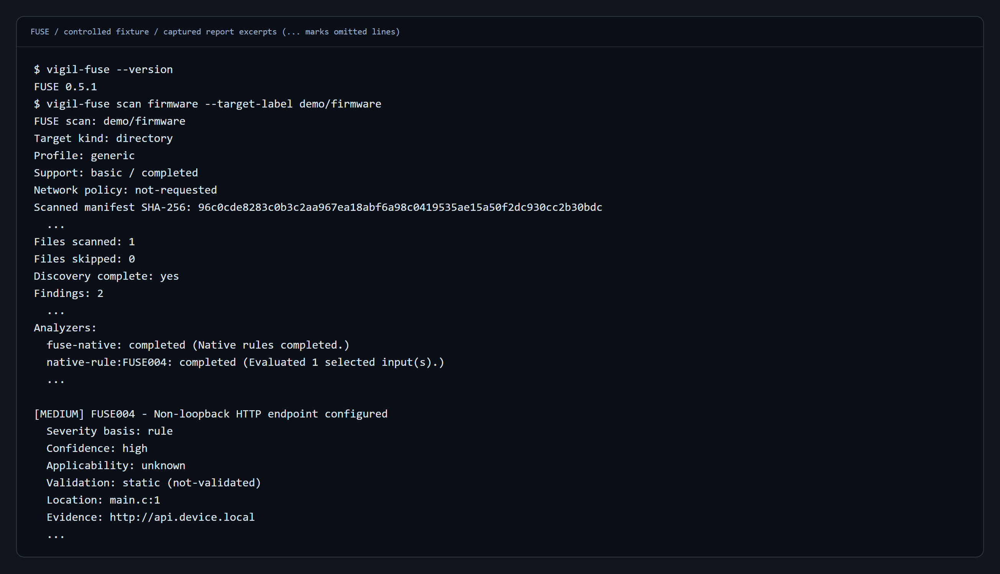
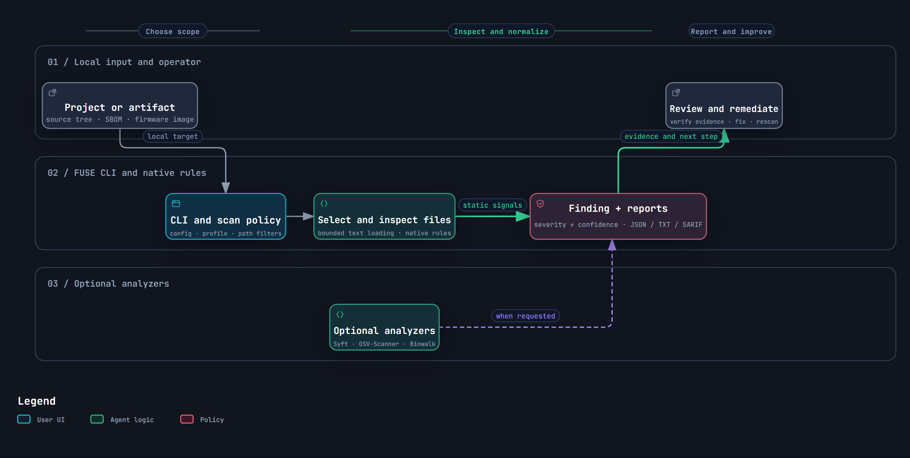
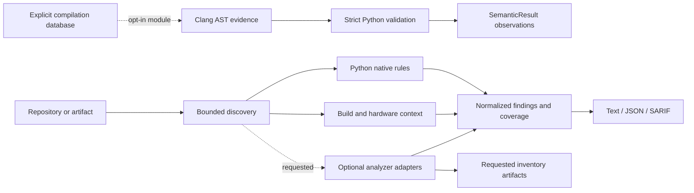

<h1 align="center">FUSE</h1>
<h3 align="center">Firmware &amp; Unified Security Engine</h3>

<p align="center">Evidence-driven security analysis across source code, firmware, build context and hardware artifacts.</p>

<p align="center">
  <a href="https://github.com/ShivuXD/FUSE/actions/workflows/ci.yml"></a>
  <a href="pyproject.toml"></a>
  <a href="src/vigil_fuse/__init__.py"></a>
  <a href="LICENSE"></a>
</p>

<p align="center"><a href="#quick-start">Quick start</a> · <a href="#how-fuse-scans-a-project">Scan pipeline</a> · <a href="#what-fuse-analyzes">Supported inputs</a> · <a href="#documentation">Documentation</a></p>



*Faithful rendering of captured CLI excerpts from a controlled fixture scan, not an OS screenshot. Omitted lines are marked. [Full output and reproduction notes](docs/assets/readme/README.md).*

## What FUSE does

FUSE inspects embedded and IoT projects without executing target code. Its deterministic Python core combines bounded source checks, selected build metadata, firmware evidence, hardware context and optional external analyzers into normalized findings with explicit coverage. It runs locally, with no required cloud service or AI model.

FUSE brings source, build, firmware and hardware evidence together while keeping confidence, applicability and coverage distinct. This is the product's focused position; we have not completed a market-wide competitor survey and do not claim that no competing products exist.

**SOURCE → BUILD → FIRMWARE → HARDWARE → FUSE EVIDENCE**

These are related evidence layers, not five mandatory stages in every scan. A source literal, a selected build setting, an image reference and a debug-net connection answer different questions about a product.

| Principle | In practice |
| --- | --- |
| **Cross-layer evidence** | Review source signals alongside build, component, image and board context in a common report. |
| **Evidence over assumptions** | Static presence does not establish runtime execution or physical exploitability. |
| **Explicit uncertainty** | Skipped files, unavailable tools, unsupported inputs and partial analysis remain visible. |

<details>
<summary>Contents</summary>

[Pipeline](#how-fuse-scans-a-project) · [Architecture](#architecture) · [Evidence](#evidence-before-verdicts) · [Quick start](#quick-start) · [CLI](#cli-usage) · [Inputs](#what-fuse-analyzes) · [Clang](#compiler-semantic-cc-evidence) · [Outputs](#reports-you-can-review) · [Trust](#trust-boundaries) · [Validation](#built-to-be-testable) · [Languages](#built-polyglot-intentionally) · [Status](#current-state) · [Direction](#where-fuse-can-go-next) · [Docs](#documentation) · [Limits](#limitations) · [Competition](#competitive-landscape-and-architectural-differentiation) · [License](#license-and-attribution)

</details>

## How FUSE scans a project



[Open the interactive pipeline →](https://sathack-vigil-fuse.vercel.app/diagrams/fuse-scan.html) · [Standalone HTML source](site/diagrams/fuse-scan.html).

Interactive workflow visualization generated with Archify. This preview captures the existing file; Archify is not a FUSE runtime dependency. [Third-party credits](docs/THIRD_PARTY_CREDITS.md) preserve its attribution and the embedded font notice.

The target passes through bounded discovery, native and contextual checks, then only the optional analyzers requested by the operator. FUSE validates external evidence, normalizes findings and writes coverage-aware reports. The overview names a subset of external tools; the current integration list is below.

## Architecture



Python owns scan policy, evidence interpretation and reporting. Native rules run in a killable worker with deadlines. External adapters have bounded inputs, subprocess output and artifact validation. The separate Clang module returns observations; ordinary `scan` does not automatically run it or turn its calls into findings.

The local CLI is the primary interface. The optional Go/Kubernetes foundation schedules an identity probe only, with explicit evidence handoff. See [architecture](docs/architecture.md), [polyglot boundaries](docs/architecture/polyglot-platform.md) and [execution backends](docs/architecture/execution-backends.md).

## Evidence before verdicts

```text
PRESENT ≠ BUILD_INCLUDED ≠ runtime execution ≠ physical accessibility
```

`PRESENT`, `BUILD_INCLUDED` and `UNKNOWN` are Clang coverage terms. A selected translation unit that parses is build-included evidence within that database, not proof that its functions execute. Runtime execution and physical accessibility are separate questions, not claimed coverage states.

| Dimension | Question |
| --- | --- |
| Severity | What is the potential impact? |
| Confidence | How strong is the evidence for this detection? |
| Applicability | Does this signal apply to the shipped target? |
| Coverage | What inputs and analysis stages actually completed? |
| Validation | Was this only static evidence, or independently validated? |

FUSE keeps these judgments separate instead of manufacturing a combined risk number.

<details>
<summary>Explore the finding model</summary>

<picture>
  <source media="(prefers-color-scheme: dark)" srcset="docs/figures/fuse-finding-model.svg">
  <source media="(prefers-color-scheme: light)" srcset="docs/figures/fuse-finding-model-light.svg">
  
</picture>

This teaching illustration is not physical FUSE hardware. [Finding fields and schema](docs/finding-schema.md).

</details>

## Quick start

Use the repository to get the capabilities described here. Requires **Python 3.11+** on Windows, Linux or macOS; the core scanner has no runtime dependencies.

```sh
git clone https://github.com/ShivuXD/FUSE.git
cd FUSE
python -m venv .venv
```

Activate with `.venv\Scripts\Activate.ps1` in PowerShell or `source .venv/bin/activate` on Linux/macOS. Use `python3` to create the environment if your system does not provide `python`. Then:

```sh
python -m pip install .
vigil-fuse doctor
vigil-fuse scan ./project --plan
vigil-fuse scan ./project --output-dir .fuse-results
```

Replace `./project` with your local target. On Windows, activation is optional: use `.\.venv\Scripts\python.exe -m pip install .` and `.\.venv\Scripts\vigil-fuse.exe doctor` directly.

[Detailed setup and configuration](docs/usage.md). Optional analyzers require separate trusted installations. `vigil-fuse setup --recommended --dry-run` previews the explicit user-local setup plan. No setup mode downloads a model.

## CLI usage

Preview discovery, select build context without running its build system, or request external evidence:

```sh
vigil-fuse scan ./project --profile esp-idf --plan
vigil-fuse scan ./project --profile esp-idf --build-dir build --output-dir .fuse-results
vigil-fuse scan ./project --sbom --vulnerabilities --output-dir .fuse-results
vigil-fuse scan firmware.elf --ghidra --output-dir .fuse-results
```

OSV advisory lookup can use the network; use `--no-network` for strict offline vulnerability checks with the required local database. Other opt-ins include `--git-history`, `--firmware`, `--hardware-bom` and `--hardware-netlist`. `--fail-on high` supports CI thresholds; baseline commands compare reports and apply reasoned suppressions. See `vigil-fuse scan --help` and [usage](docs/usage.md).

Run `vigil-fuse` in a terminal for the persistent shell. `/help`, `/doctor`, `/pwd`, `/cd PATH`, `/scan PATH [OPTIONS]`, `/baseline`, `/version`, `/clear` and `/exit` are supported by the active shell. `/scan . --plan` previews the current folder without scanning. Install `python -m pip install ".[cliui]"` for completion and session-only command-name history; basic input works without it.

## What FUSE analyzes

Labels follow the [machine-readable support matrix](src/vigil_fuse/support-matrix.json). **Detected** means inventory, **basic** means narrow native checks, and **experimental** means an opt-in or evolving contract. None implies complete product coverage.

| Layer | Inputs and evidence | Current scope |
| --- | --- | --- |
| Source | Selected C/C++, Python, text and configuration; seven native rules | Basic: credential-like literals, key markers, TLS bypasses, HTTP/MQTT and ESP-IDF image-validation settings |
| Build | ESP-IDF, Zephyr, PlatformIO; compilation database metadata | Experimental adapters; database inventory is detected only |
| C/C++ semantics | Explicit compilation database with allowed `arguments` arrays | Experimental, separate Clang module; observations only |
| Firmware | Candidate filenames; selected image with Binwalk or Ghidra | Detected inventory; experimental signatures and static binary evidence |
| Hardware | Design/CAD/HDL filenames; CSV/TSV BOM; KiCad XML netlist | Detected inventory; experimental BOM import and debug-connectivity candidates |
| Supply chain | CycloneDX/SPDX, OSV, Git history, VEX and SLSA digest context | Basic advisory matching; experimental history and product-context adapters |
| RTL | `.v`, `.vh`, `.sv`, `.svh`, Yosys references and FPGA constraints | Experimental bounded structure and four candidate checks; no elaboration or silicon proof |
| Policy | Explicit OPA/Rego policy over normalized scan evidence | Separate PASS/FAIL/UNKNOWN artifact; policy failures are not vulnerabilities |
| Workflows | Selected GitHub Actions permission, reference and interpolation patterns | Basic static checks |
| Research foundations | Device-tree/SVD parsing, cFE bus evidence, resilience indicators and Renode export | Experimental Python APIs; partial evidence, no device execution |

Firmware filename recognition does not inspect bytes. Ghidra recognizes ELF, PE and Mach-O magic, but loader and processor success depend on the input and tested toolchain. Raw images need an explicit language ID and base address. Hardware net connectivity does not establish physical access.

### Optional analyzers

| Tool | Role and boundary |
| --- | --- |
| Syft | Generates CycloneDX software inventory. |
| OSV-Scanner | Matches package identities to advisories; inclusion and reachability remain separate. |
| Binwalk | Identifies selected image signatures without extraction. |
| Gitleaks | Scans commits reachable from `HEAD`; FUSE retains redacted metadata. |
| Ghidra 12.2 + JDK 25+ | Exports bounded static binary metadata through the Java bridge. |
| Clang/LLVM | Supplies compiler-semantic observations through the separate native producer. |

Optional analyzers provide evidence. FUSE validates and normalizes their output. Missing tools remain visible without preventing native scans. Docker isolation is available for Syft, OSV-Scanner, Binwalk and Gitleaks; Ghidra and the Clang host adapter are outside that sandbox path.

## Compiler-semantic C/C++ evidence

```text
compile_commands.json → Clang LibTooling → AST observations
                     → strict JSON contract → Python validation
```

The opt-in producer preserves call sites, arguments, macro locations and selected-build inclusion. It rejects unsupported compiler arguments. It does not add symbolic execution, taint tracking or automatic vulnerability verdicts.

The committed controlled benchmark records **12 translation units, 79 AST observations and 30 selected API call sites**, with **30/30 fixture-call inventory matches**. This measures selected call recognition on a controlled fixture corpus, not vulnerability precision or recall. The corpus uses stand-in API declarations, not physical tests or general SDK validation. [Method, toolchain, bounds and raw evidence](docs/cpp-semantic-analysis.md#coverage-and-validation).

## Reports you can review

A scan with `--output-dir .fuse-results` writes:

```text
.fuse-results/
├── findings.txt
├── findings.json
└── findings.sarif
```

JSON includes findings, coverage, inventories and input/artifact hashes within each stage's declared scope. Requested successful stages can also write `components.cdx.json`, `hardware-bom.cdx.json` or `ghidra-analysis.json`. These are conditional artifacts. [Report contract](docs/finding-schema.md) · [SBOM behavior](docs/sbom.md).

One excerpt from the **controlled fixture scan** shown above:

```text
[MEDIUM] FUSE004 - Non-loopback HTTP endpoint configured
  Severity basis: rule
  Confidence: high
  Applicability: unknown
  Validation: static (not-validated)
  Location: main.c:1
  Evidence: http://api.device.local
```

The full report contains two findings from one scanned file, with discovery complete and native analysis completed in that scope. This records configured HTTP strings, not third-party product exploitability.

## Trust boundaries

Project inputs and analyzer outputs are untrusted. FUSE does not execute project code, compiler commands from a compilation database, or firmware. Host analyzers parse inputs with the current user's permissions; subprocess limits are not an OS sandbox.

Explicit Docker mode uses trusted local digest-pinned images, read-only inputs, resource limits and no network by default. Online OSV lookup needs explicit container network permission. The Docker daemon and images remain trusted. FUSE does not flash devices, probe services or validate physical hardware.

<details>
<summary>View the trust-boundary diagram</summary>


</details>

[Threat model](docs/threat-model.md) · [Analyzer isolation settings](docs/usage.md#run-optional-analyzers-in-docker).

## Built to be testable

The checked-in CI defines Linux tests on Python 3.11–3.14, Windows/macOS tests on Python 3.11, Ruff, strict Mypy, documentation checks and Mermaid rendering, coverage, package build/install checks and Docker fixture integration. Separate workflows cover CodeQL and selected external analyzers. Workflow configuration is not a claim that every current job passed; the CI badge links to live results.

Native rules have positive and secure controls. Contract tests cover malformed evidence, bounds and architecture dependencies. The Clang corpus and operator probe have separate validation records. [Contributing](CONTRIBUTING.md) · [Compatibility and CI evidence](docs/compatibility.md).

Historical [repository performance samples](docs/experiments/repository-scan-performance-matrix-2026-10-31.md) record pinned scopes, warm-up/repeats, memory sampling and partial coverage. They are descriptive hosted-runner measurements, not a speed ranking or current-release benchmark. The [0.4.0 completion record](docs/PROJECT_COMPLETION.md) is historical release evidence, not certification of newer features. Independent human adjudication and field accuracy remain pending. A later pinned NVIDIA/edk2-nvidia run at `cb638768ec174bb2041f87569409c53e4af4292e` selected and scanned 1,223 files with zero skips and one medium FUSE001 candidate, high confidence, unknown applicability, not validated. Consolidation preserved its fingerprint and evidence states; this is not a confirmed NVIDIA vulnerability. See the [audit](docs/final-consolidation-audit.md).

## Built polyglot, intentionally

| Language | Implemented responsibility |
| --- | --- |
| Python | Deterministic scanning, policy, evidence validation, applicability, coverage and reports; passive planning models |
| C++ | Optional Clang LibTooling producer with strict evidence interchange |
| Go | Experimental Kubernetes identity-probe scheduling and operational state; no security classification |
| Java | FUSE-owned `FuseExport.java` bridge inside an external Ghidra installation |
| C / C++ fixtures | Controlled analysis targets and regression evidence, not runtime dependencies |
| R | Optional offline statistical scripts over manually prepared CSV data |
| Julia | Optional synthetic experiment planning and simulation research |

Numerical and statistical research languages are not runtime components. Rust is explicitly deferred under [`NO_RUST_NEEDED_YET`](docs/native-engine-strategy.md); Zig remains `NO_ZIG_NEEDED`. Neither toolchain is required. Optional [R](research/R/README.md) and [Julia](research/julia/README.md) research scripts do not run during scans. [Platform boundaries](docs/architecture/polyglot-platform.md).

## Current state

**Alpha, source version 0.5.1.** Current `main` includes the core scanner, reports, interactive shell, optional firmware/hardware integrations, passive adaptive planning foundations, the experimental Clang evidence module and the probe-only Go operator. Source version does not establish a matching PyPI release.

Development has moved beyond the earlier maintenance-only completion declaration. The Clang stage is not automatic scan policy, and Kubernetes job success is not security success. Explicit setup, optional Rego evaluation, bounded RTL analysis, embedded applicability reports, optional R/Julia research, and local reasoning are integrated. Optional local reasoning reads bounded evidence from a completed deterministic finding and writes a separate validated explanation with suggested checks and remediation. It cannot create or change findings; suggestions are inert text, and FUSE does not author or apply patches. Model output is lower trust than scan evidence and needs human review. One installed Qwen smoke produced valid JSON but failed UNKNOWN acknowledgement validation; rejected output is not accepted as evidence. See [local reasoning](docs/local-reasoning.md), [execution limits](cluster/fuse-operator/README.md) and the [roadmap](docs/roadmap.md).

## Where FUSE can go next

**Future / research**, not promised capabilities:

- Richer selected-build and applicability evidence with preserved uncertainty.
- Broader policy coverage and reviewed correlation across evidence classes.
- Evaluate the existing opt-in local reasoning feature for a future beta, including grounded explanations and useful remediation suggestions. Deterministic FUSE analysis remains responsible for findings; model output stays advisory and cannot apply patches. See [reasoning limits](docs/local-reasoning.md).
- Stronger spacecraft protocol and silicon trust evidence beyond current parsing foundations.
- Digital-twin fault injection beyond today's static model/export boundary.
- Analyzer workers beyond the Kubernetes identity probe, with validated evidence handoff.

[Adaptive expansion scope](docs/research/adaptive-expansion-scope.md) · [Roadmap](docs/roadmap.md) · [Native engine decision](docs/native-engine-strategy.md).

## Documentation

| Intent | Start here |
| --- | --- |
| **Use FUSE** | [Installation](docs/installation.md) · [Consolidation audit](docs/final-consolidation-audit.md) · [Usage](docs/usage.md) · [Configuration and integrations](docs/integrations.md) · [Compatibility](docs/compatibility.md) |
| **Understand evidence** | [Architecture](docs/architecture.md) · [Finding model](docs/finding-schema.md) · [Threat model](docs/threat-model.md) · [Limitations](docs/limitations.md) |
| **Choose analyzers** | [RTL](docs/rtl-security-analysis.md) · [Local reasoning](docs/local-reasoning.md) · [OPA/Rego policy](docs/policy-as-code.md) · [Ghidra](docs/ghidra-analysis.md) · [Firmware](docs/firmware-analysis.md) · [Hardware](docs/hardware-analysis.md) · [Clang semantics](docs/cpp-semantic-analysis.md) |
| **Inspect engineering** | [Benchmarks](docs/benchmarks.md) · [Experiments](docs/experiments/) · [Roadmap](docs/roadmap.md) · [Traceability](docs/traceability.md) |
| **Review research** | [Repository scans](reports/repository-scans/README.md) · [Embedded evaluation](reports/evaluation/2026-11-14/README.md) · [Independent evaluation protocol](docs/research/independent-evaluation-protocol.md) |


## Competitive landscape and architectural differentiation

General-purpose application security testing (SAST), firmware extraction tools, and secret scanners operate in isolated silos. None bridge the gap between compiler syntax, physical silicon, printed circuit board (PCB) traces, and aerospace flight networks.

```text
+-----------------------------------------------------------------------------+
|                          THE SILO PROBLEM IN SECURITY                       |
+-----------------------------------------------------------------------------+

   SOFTWARE SAST              FIRMWARE SCANNERS           HARDWARE EDA (PCB)
  (Semgrep, CodeQL)            (EMBA, FACT)                  (KiCad, Altium)
 +-----------------+        +-----------------+         +-----------------+
 | Reads code text |        | Unpacks Linux   │         | Checks copper   |
 | like a document |        | root filesystems│         | trace widths    |
 +--------+--------+        +--------+--------+         +--------+--------+
          |                          |                           |
          v                          v                           v
 X Blind to PCB wiring      X Blind to Bare-Metal       X Blind to software
 X Blind to space physics   X 2-4 hr runtime, 40GB+     X Unaware of code
 X Massive false alarms     X Peripheral wall halt        vulnerabilities
          |                          |                           |
          +--------------------------+---------------------------+
                                     |
                                     v
                      +-----------------------------+
                      |    FUSE UNIFIED ENGINE      |
                      |  C AST + DTS + PCB + cFS    |
                      +-----------------------------+
```

### Comparative benchmark matrix

| Capability / Evaluation Dimension | FUSE (v0.5.1) | Enterprise SAST (Semgrep, SonarQube) | Firmware Unpackers (EMBA, FACT) | Commercial Platforms (Finite State, Cybellum) | Secret & SCA Scanners (Gitleaks, Snyk) |
| :--- | :---: | :---: | :---: | :---: | :---: |
| **Primary Domain Focus** | **Embedded, IoT & Aerospace** | Web & Cloud Apps | Linux Router Images | Enterprise Binary SCA | Cloud Git & Web Dependencies |
| **Cross-Layer Physical Reachability** (KiCad `.net` S-expressions) | **Native (7 states)** | None | None | None | None |
| **Device Tree Hardware Offsets** (Open Firmware `.dts` MMIO) | **Native** | None | None | None | None |
| **Aerospace Software Bus Policy** (NASA cFS / cFE Message IDs) | **Native (`flight_policy.toml`)** | None | None | None | None |
| **Cosmic Radiation Bit-Flip Resilience** (SEU / TMR Static Audit) | **Native** | None | None | None | None |
| **Compiler AST Semantics** (C/C++ Control Flow) | **Clang 18.1 LibTooling** | Generic AST / Regex | Disassembly only | Disassembly only | Regex text matching |
| **Execution Architecture & Dependencies** | **Air-gapped Python stdlib (0 pip deps)** | Heavy runtime / Cloud | 50+ toolchain, 40GB+ | Proprietary Cloud SaaS | Cloud / Package dependencies |
| **Bare-Metal & RTOS Support** (FreeRTOS, Zephyr, cFS) | **Native** | Source only | Fails on non-Linux | Partial binary | None |
| **Execution Performance on Enterprise Targets** | **<3.2s on 1,223 files** | 1 to 5 Minutes | 1 to 4 Hours | 15 to 60 Minutes (Cloud) | Seconds (Secrets only) |
| **Epistemic Model & Uncertainty** | **5D Evidence (`UNKNOWN` first-class)** | Compressed CVSS score | Binary pass / fail | Subjective risk score | Binary pattern match |
| **RTL Silicon Security** (Verilog / SystemVerilog) | **Native (Verible / Fallback)** | None | None | None | None |

### Key category deficits

1. **Why Enterprise SAST (Semgrep, SonarQube, CodeQL) Fails in Embedded:**
   - **Hardware-Agnostic:** Code linters treat C source as text. They lack models for Memory-Mapped I/O (MMIO), register base addresses, and microcontroller pin multiplexing.
   - **Zero Physical Reachability:** They cannot parse KiCad PCB Netlists or schematics. An insecure UART routine is reported as `CRITICAL`, even if the physical microcontroller pins are unrouted on copper or sealed inside an enclosure.
   - **False-Positive Fatigue:** Unresolved macro expansions and pointer arithmetic produce 85–95% false-positive rates on bare-metal firmware.

2. **Why Linux Firmware Scanners (EMBA, FACT, Binwalk) Fail in Aerospace:**
   - **Linux-Centric Assumption:** They expect a Linux root filesystem (`/bin/sh`, `/etc/shadow`, dynamic libraries). They fail completely on bare-metal firmware, microcontrollers (STM32, ESP32, nRF52), and flight RTOS kernels (RTEMS, Zephyr, FreeRTOS).
   - **Peripheral Wall in Emulation:** Dynamic emulation crashes when firmware writes to physical MMIO registers absent in QEMU. FUSE avoids this via bounded non-executing static analysis and CMSIS-SVD digital twin synthesis.
   - **Glacial Runtime:** EMBA requires 1 to 4 hours per scan; FUSE executes in under 3.2 seconds.

3. **Why Commercial Firmware Security SaaS (Finite State, Cybellum) Fails in Defense:**
   - **Cloud SaaS Barrier:** Defense primes (Lockheed, Raytheon, NASA contractors) working in air-gapped SCIFs cannot upload classified, ITAR-restricted satellite firmware to third-party cloud servers.
   - **No Schematic Integration:** They do not parse EDA netlists or flight software message buses.

See [competitive landscape and deficit analysis](docs/competitive-landscape.md) for the full evaluation methodology.

## Limitations

A clean report means enabled checks did not match within the scanned scope. Seven core native rules and four RTL candidate rules are narrow indicators, not a complete language or vulnerability analysis. Build metadata does not prove shipment; advisory matches do not prove vulnerable code runs. Static firmware evidence does not prove exploitability, and hardware inventories do not validate a board. Unsupported inputs and unavailable stages can leave partial coverage.

There is no physical-device or hardware-in-the-loop validation. Controlled fixtures do not establish independent field precision or recall. Read the [full limitations](docs/limitations.md) before interpreting results.

## License and attribution

**FUSE · Firmware & Unified Security Engine · Team VIGIL.** Copyright © 2026 Shantanu, Shivam, and Armaan Malhotra.

Source-available under the **VIGIL-FUSE Restricted Use License v1.2**, not an OSI-approved open-source license. Use, private modifications, analysis outputs and redistribution have distinct terms; read [LICENSE](LICENSE) before distributing copies or publishing modifications. Earlier license grants remain governed by the terms attached to those copies.

[Third-party credits](docs/THIRD_PARTY_CREDITS.md) cover external tools and visual assets. Referencing a tool or standard does not imply endorsement or affiliation. [Security reporting](SECURITY.md) · [Contributing](CONTRIBUTING.md).

Made by: Shantanu, Shivam, and Armaan Malhotra
